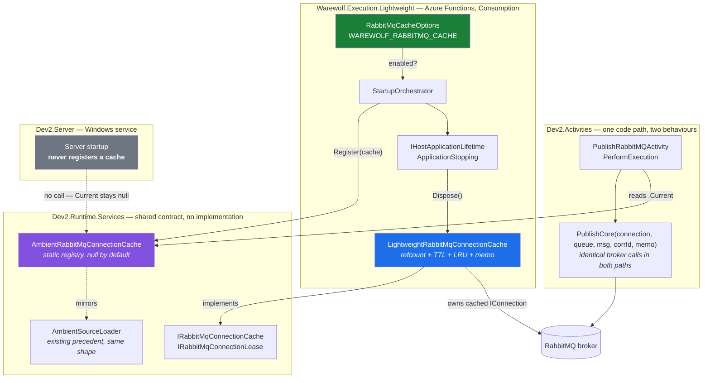
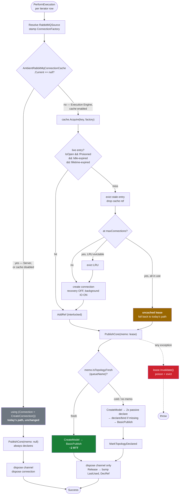
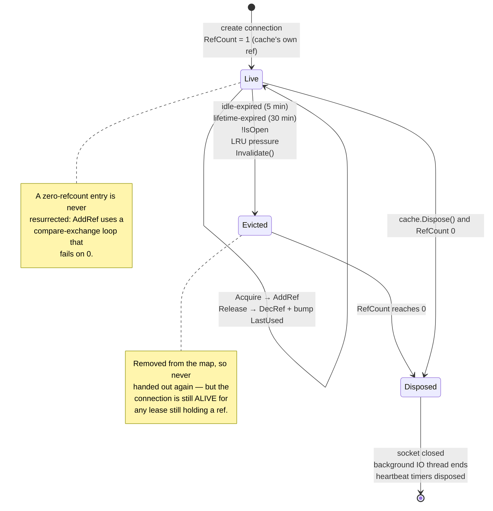
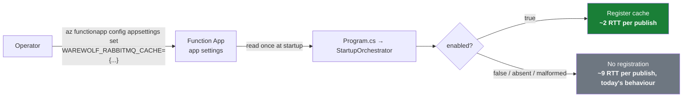

# RabbitMQ connection cache — how it fits the Execution Engine, Dev2.Activities and the Server

Companion to [`RabbitMQ-ConnectionCache-Plan.md`](./RabbitMQ-ConnectionCache-Plan.md).

---

## 1. Component fitment

The load-bearing idea: **the shared library declares the contract, the Execution Engine supplies the
implementation, the Server supplies nothing.** `Dev2.Activities` depends only on the interface, so the
Server keeps today's behaviour without a single conditional referring to a host.

**Reading the diagram.** The only arrow that differs between hosts is `Register(cache)`. Everything in
`Dev2.Activities` is host-agnostic: it asks `AmbientRabbitMqConnectionCache.Current` and gets either a
cache (Execution Engine, when enabled) or `null` (Server, always; Execution Engine when disabled).

---

## 2. The decision at publish time

---

## 3. Cache entry lifecycle — where disposal actually happens

The states exist to make one guarantee explicit: **a connection is disposed exactly once, by whichever
party takes the reference count to zero.** Eviction alone never disposes, because another thread may be
mid-publish on that connection.

---

## 4. What is bounded, and by what

| Resource | Bound | Enforced by |
|---|---|---|
| Cached connections | `maxConnections` (default 4) | cap + LRU eviction |
| Connection age | `maxLifetime` (default 30 min) | absolute clock, checked at acquire + sweep |
| Idle connection | `idleTimeout` (default 5 min) | sliding clock, bumped on release |
| Topology memo entries | per-entry expiry (`topologyTtl`, default 30 s) + size cap | swept with the entry |
| Channels per connection | 1 per in-flight publish | fresh `IModel`, disposed in `finally` |
| Sweep timers | exactly 1 per cache instance | single `Timer`, disposed with the cache |
| Recorded topology (`m_recorded*`) | **does not exist** | `AutomaticRecoveryEnabled = false` ⇒ plain `Connection` |
| Foreground threads | **zero** | `UseBackgroundThreadsForIO = true` |

---

## 5. Deployment view

Changing the setting restarts the Function App, which is the intended contract — TTLs and the cap are
baked into the cache instance at construction (see plan §4.5). No deploy-script change is required:
an absent variable means disabled.
